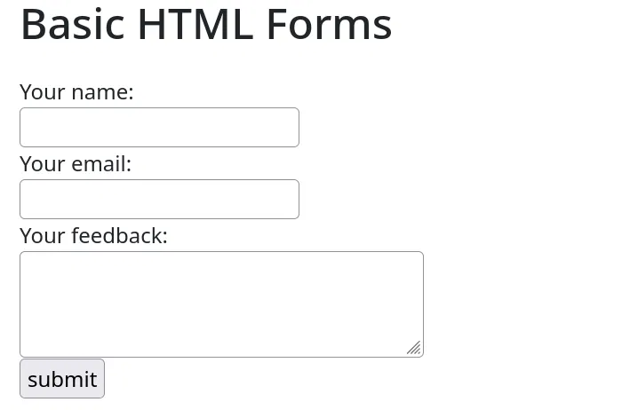
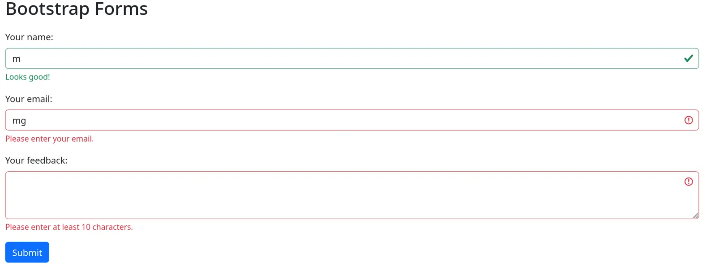
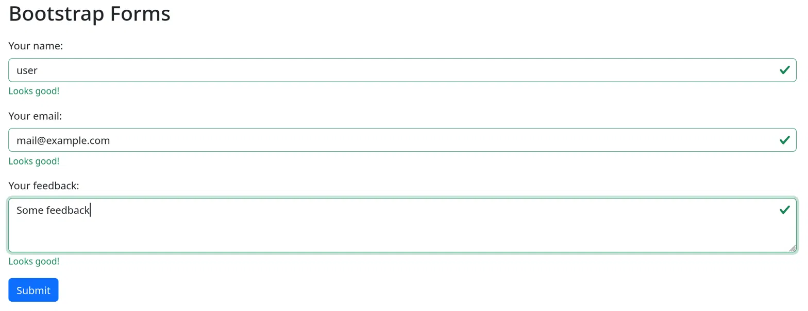
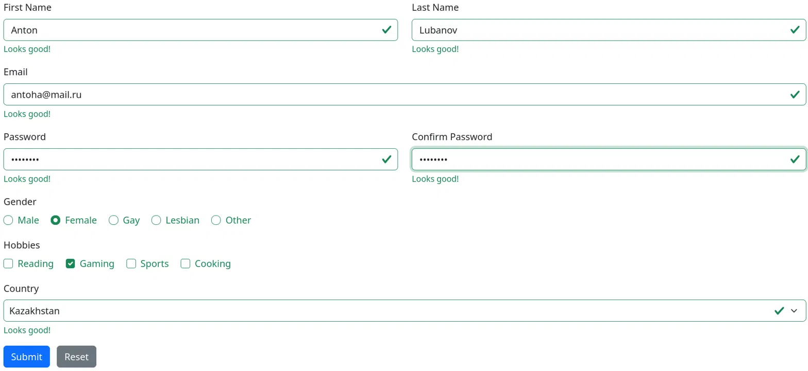

# Assignment 4

**Name:** Ilya Koval
**Group:** SE-2539

---

## Part 1. Basic HTML Forms

### Task 0. Simple Contact Form

Created a basic contact form that includes the following fields:
- Name (text input),
- Email (email input),
- Message (textarea),
- And a submit button

All of the fields have their corresponding `<label>` elements.

### Task 1. Form with HTML5 Validation

Added some built-in HTML5 validation with attributes such as
`required` to prevent submission of empty fields,
`type="email"` - browser enforces correct email format,
`minlength="10"` and `maxlength="100"` for the textarea.

---

## Part 2. Bootstrap Forms

### Task 2. Bootstrap Form Styling

Recreated the contact form with the help of Bootstrap form classes,
applied `form-control` to inputs and textareas,
`form-label` to the labels,
`mb-3` for spacing between elements,
`btn btn-primary` to the button, etc.

### Task 3. Bootstrap Validation Styles

Used Bootstrap's validation styles to display errors and successes.
Added `novalidate` attribute to the form to prevent default browser validation, then used JavaScript to add
`was-validated` class on submit. Placed `invalid-feedback` and `valid-feedback` divs below each of the fields. The script also prevents the default form submission with `e.preventDefault()`.

---

## Part 3. Advanced Form Project

### Task 4. Registration Form

Created a registration form with the following fields:
- First Name, Last Name (put them in one row, two columns wide),
- Email,
- Password and Confirmation (another row with two columns),
- Gender (radio buttons),
- Hobbies (checkboxes),
- Country (dropdown),
- Submit and Reset buttons.

For the layout, used Bootstrap's grid system (the `row` and `col-md-6` classes).
For validation, used HTML5 attributes `required`, `type="email"`, `minlength="8"`, et cetera. For Bootstrap validation, again added the `novalidate` attribute and used the JavaScript event listener to add the `was-validated` class on submit.

Checked if the values of the password and confirmation fields matched with `setCustomValidity()`. For gender, since there is no built-in validation for radio buttons in Bootstrap, had to write a little custom JavaScript that would display an error message if none of the options was selected. And finally, added a click event listener to the reset button to remove the `was-validated` class when the button is clicked.

---

## Summary

In this assignment I learned how to build HTML forms and apply validation to them with the help of HTML5 attributes, and style them with Bootstrap. Learned about semantic HTML and how to use the `<label>` element with the `for` attribute and checkboxes and radio buttons. Explored Bootstrap form components and learned how to use `form-control`, `form-label`, `form-select`, and `form-check` classes and how to lay out forms with Bootstrap's grid system. Played around with Bootstrap's validation feedback and learned how to enable it by adding the `was-validated` class with a little bit of JavaScript. Also learned how to write some custom validation code for password confirmation and radio buttons since Bootstrap does not support it out of the box.
